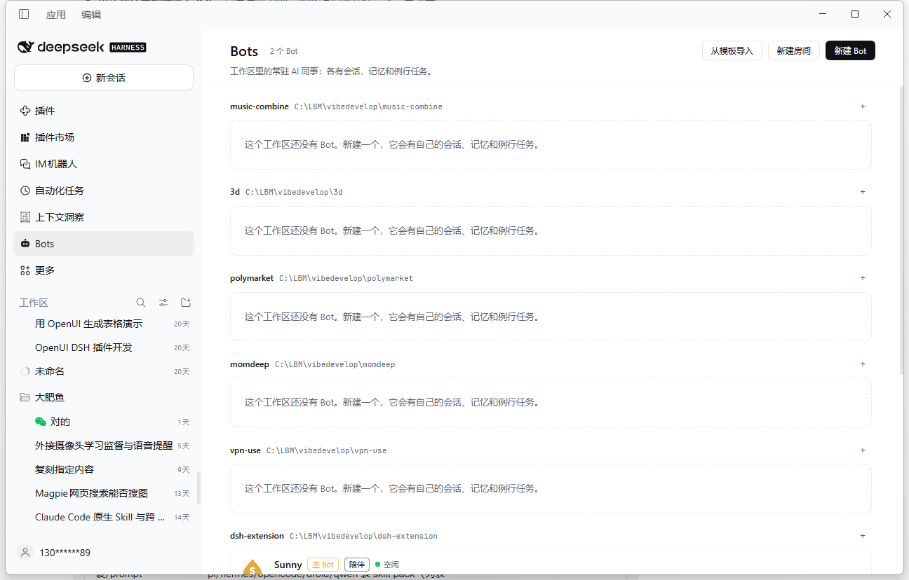

<p align="center">
  
</p>

<h1 align="center">dsh-grok-bot</h1>

<p align="center">
  给 DeepSeek Harness 的常驻工作区 Bot：<br/>
  自己的会话、人格与记忆，会自己醒来，也会把活派给别的 Bot。
</p>

<p align="center">
  <a href="LICENSE"></a>
  
  
</p>

> Grok Bot 只是功能参照；本插件与 xAI 无关联，也不含任何品牌素材。



## 为什么是 Bot，而不是又一个聊天窗口

普通会话是「你问，它答」。Bot 是工作区里的一个**常驻角色**：

- 有自己的 Session、名字、人格和四档模式；
- 有独立的长期记忆，跨会话不丢；
- 会按自己的例行任务醒来，没事就静默收尾；
- 能把活派给同工作区的其他 Bot 或普通会话，并把对方的结论带回来；
- 2–6 个 Bot 还能进同一个房间，互相 @、自己聊。

所有数据都落在**当前工作区**的 `.deepseek-harness/bots/` 里，跟项目记忆同目录，不经过云端。

## 能力

| | |
|---|---|
| **建 Bot** | 面板里填名字、简介、模式、头像形状与配色、人格补充；保存即落盘，同时建一个独立 Session 并改成 Bot 的名字 |
| **单聊** | 点 Bot 行的 ↗ 打开它的原生会话；身份、模式、记忆每轮自动注入 |
| **模式** | `companion / operator / scout / chief` 四档；只读档位不能写文件、不能跑命令，由执行守卫强制，切换立刻生效 |
| **记忆** | 每个 Bot 一份 `MEMORY.md` + 每日日志；工作区还有所有 Bot 共享的 `shared-facts.md`；`bot_memory` 可读写、搜索、遗忘 |
| **自唤醒** | 每天 / 每 N 分钟 / N 分钟后一次 / cron；宿主调度器到点唤醒冷会话；无事可报时 `bot_reclaim` 静默收尾 |
| **跨会话** | `bot_send` 可发给同工作区的 Bot 或普通会话；冷会话自动 resume；交接最多两跳，每 Bot 每分钟 10 条 |
| **派活** | `bot_open_session` 在同一个工作区新开一条普通会话，不换绑自己的会话，再用 `bot_send` 投活 |
| **房间** | 2–6 个 Bot 的常驻群聊：`@名字` 定向、无 @ 走主答、`@everyone` 广播；逐 token 流式、可停止、记录持久化 |
| **面板** | 侧栏 Bots 入口与整页面板：Bot 卡片、详情（记忆 / 例行 / 自主权 / 用量）、房间、新建与编辑、工作区设置 |

## 快速开始

**要求**：DeepSeek Harness 桌面版 `0.2.2-rc.1`（其他版本未验证）；Node 24 仅用于跑测试。

```bash
git clone https://github.com/LBM-OASIG/dsh-grok-bot.git
dsh plugin --profile desktop add link:<克隆目录的绝对路径>/dsh-grok-bot
```

Windows 下 `link:` 后面直接写绝对路径即可，例如：

```bash
dsh plugin --profile desktop add link:C:/path/to/dsh-grok-bot
```

装完刷新窗口（或重启 DSH），侧栏会出现 **Bots** 图标。第一次打开时，当前工作区还没有 Bot，面板会引导你建一个。

## 四档模式

| 模式 | 定位 | 写文件 / 跑命令 | 可私信 | 默认预算 |
|---|---|---|---|---|
| `companion` 陪伴 | 陪聊、轻任务，主动但不烦 | ✗ / ✗ | ✗ | 4 次 / 天 |
| `operator` 干活 | 接活、交付结果 | ✓ / ✓ | ✓ | 12 次 / 天 |
| `scout` 侦察 | 只读侦察，给线索不下结论 | ✗ / ✗ | ✗ | 8 次 / 天，默认静默 |
| `chief` 协调 | 拆活、派活、收口（默认主 Bot） | ✓ / ✓ | ✓ | 16 次 / 天 |

只读边界由 Agent 作用域里的执行守卫强制：越权调用会拿到明确的拒绝理由，而不是真的执行。模式切换会即时改变守卫判断和 Bot 的工具清单，不需要重建会话。

> **实现说明**：DSH 的 preset 组合在会话首轮后锁定（`agent-preset/locked`），所以插件只注册一个完整的 `grok-bot-agent` preset，把「模式」放进运行时守卫而不是 composition。这样两个方向的切换都即时生效。

## Bot 工具

这些工具只注册在 Bot 自己的 Agent 作用域，普通会话、子智能体和其他 Bot 都拿不到。

| 工具 | 作用 |
|---|---|
| `bot_memory` | 读写 / 搜索 / 遗忘本 Bot 的记忆；`shared:true` 写入工作区共享事实 |
| `bot_profile` | 读自己的名字、模式、生效预算、例行任务、记忆占用与共享事实（只读） |
| `bot_send` | 给同工作区的其他 Bot 或普通会话发消息；对 Bot 会带回对方完整回复 |
| `bot_open_session` | 在本工作区新开一条普通会话（不换绑自己的会话），再用 `bot_send` 投活 |
| `bot_routine` | 管理自己的例行任务：list / create / update / delete / run_now |
| `bot_reclaim` | 只在例行唤醒回合有效：无事可报时静默收尾 |
| `bot_room_post` | 在房间回合内显式补一条房间消息 |

`bot_send` 的细节：交接最多两跳，每 Bot 每分钟最多 10 条；发给 Bot 会等待对方这一轮跑完并带回完整回复，发给普通会话只回报「已送达」。

## 例行任务与预算

- 任务存在每个 Bot 的 `bot.json.routines`；宿主进程里只有一个调度器，窗口关掉、进程还在时也会到点唤醒。
- 触发时投递一条带 `[BOT ROUTINE]` 标记的宿主消息；没有值得汇报的事就调用 `bot_reclaim`，本轮记为 `silent`，不发可见汇报。
- 护栏：免打扰时段（命中不补发，推进到窗外）、每 Bot 每日 / 每小时预算、同一 Bot 不重叠唤醒、连续失败 3 次自动暂停。
- 预算只统计真实的定时唤醒：被挡下的槽位、手动「立即跑」都不占名额。
- 工作区设置页的「每 Bot 每天唤醒上限」保存后，会同步写入该工作区所有 Bot 的自主权；单个 Bot 详情里还能再调小。
- 「立即跑」绕过免打扰和预算，但仍受「同一 Bot 同时只跑一轮」约束。

## 数据落在哪里

```
<workspace>/.deepseek-harness/bots/
├─ registry.json          id 账本（永不复用）与主 Bot
├─ config.json            主 Bot、默认模式、每日/每小时预算、免打扰、房间上限、侧栏开关
├─ shared-facts.md        本工作区所有 Bot 共享的事实
├─ groups/<groupId>/      group.json + room.jsonl + runs.jsonl
└─ <botId>/
   ├─ bot.json            模式、人格、头像、自主权、routine、sessionId
   ├─ runs.jsonl          每次例行唤醒的结果
   └─ memory/             MEMORY.md + YYYY-MM-DD.md
```

聊天记录本身仍由 DSH 持久化在 `$DSH_HOME/sessions/`，插件只保存 `sessionId` 映射，不复制会话内容。

## 面板与原生 UI

- `sidebar.panellist` 增加 **Bots** 图标；`main` 同名 key 渲染整页面板。
- `sidebar.session.row.leading` 在 Bot 会话行前画它的头像。
- `conversation.session.header.actions` 在 Bot 会话标题旁显示模式徽章与运行状态。
- `plugins.bundle.config` 提供工作区级设置卡（主 Bot、默认模式、预算、免打扰、房间上限、侧栏开关）。

## Host API

```
GET  /api/dsh-grok-bot/state              全量快照
POST /api/dsh-grok-bot/action             闭合动作
GET  /api/dsh-grok-bot/events             SSE：changed / room.append / room.delta / room.status / bot.status
GET  /api/dsh-grok-bot/room?id=…&before=… 房间分页
```

动作包括：

```
bot.create | update | delete | duplicate | pin | hide | rebuild_session
bot.open_session | open_chat | send | export | import
memory.read | write | append | forget        shared.read | write
routine.create | update | delete | run_now   config.update
group.create | update | delete
room.post | stop | history
```

请求体上限 64 KB；非法输入返回 `{ ok: false, code, message }`。

## 边界

- **宿主必须活着**：窗口关掉没关系，但 DSH 进程退出后不会再唤醒；没有云端 7×24。
- **共享同一台机器**：Bot 之间共享 cwd、文件系统和权限，没有「每个 Bot 一台云电脑」。
- **没有每 Bot 独立沙箱**：沿用 DSH 现有的审批与工具守卫。
- 不做语音、Slack / X Chat、团队共享 Bot、Bot 市场。
- 删除 Bot 会删除它的记忆目录，并归档它的会话；历史仍留在 DSH 里，可恢复。

## 开发

```bash
npm test
```

`client.js` 是手写的 Module Loader 包（与 `dsh-seat-lab` 同一种形态），没有构建步骤，改完刷新窗口即可。宿主代码改动后，在插件管理器里禁用/启用 `dsh-grok-bot` 这一行即可热重载，不必重启 DSH。

> 热重载时工具注册会「认领」Agent 上已有的同名工具并替换定义，而不是重新注册或销毁；这样不会因为同名 undo 误删新注册，也不会出现 `bot_send` 变 `unknown tool`。

## 验证

- 47 个用例全过：`domain / store / engine / rooms / guard / scheduler / sessions / messaging`。
- 真机验证：建 Bot → 独立 Session → 侧栏头像与 header 徽章；`bot_memory` 落盘并在下一轮注入；一次性 routine 到点唤醒、silent 收尾、`report:"room"` 自动投递；`bot_send` 跨会话送达并回带回复；房间 @ 定向 / 无 @ 主答 / `@everyone` 广播、停止与逐 token 流式。
- 冷启动恢复：另起一个全新宿主进程，Bot、mode、sessionId、routine.nextAt、记忆与房间成员均从磁盘恢复。
- 热重载与宿主重启后 `bot_*` 工具保持可用（0.1.2）。

## 许可证

[MIT](LICENSE)
